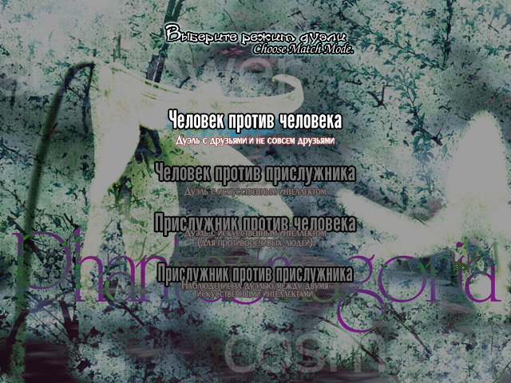

# Русификатор Touhou 9 для Steam

Готовый пакет русского перевода **Touhou Kaeizuka — Phantasmagoria of Flower View** (Steam AppID `1420810`). Перевод отображается в самой игре: меню, выбор персонажей, диалоги и элементы интерфейса.

Основа перевода — **Touhou Patch Center, `lang_ru`**, загрузчик — **thcrap**. Этот проект упаковывает существующий перевод и добавляет установку и запуск для Steam. Авторство перевода принадлежит участникам Touhou Patch Center.

**[Скачать русификатор v1.0.0](Touhou9-Russian-Steam-v1.0.0.zip?raw=1)**



## Поддерживаемые версии

- Исходная Steam-версия: EXE распознаётся thcrap как **1.00a**, в оригинальном заголовке игры отображается `ver 1.00`.
- Оригинальная версия **1.50a** после официального обновления также распознаётся загрузчиком.
- Пакет предназначен для Windows 10/11 и 32-битной игры. На 64-битной Windows используется тот же 32-битный загрузчик.

Пакет не обновляет Steam-версию до 1.50a. `th09.exe` и `th09.dat` остаются оригинальными; перевод применяется к запущенному процессу игры. Сетевые моды и отдельный интерфейс Multiplayer в комплект не входят.

## Быстрая установка

1. Установите Touhou 9 через Steam и один раз запустите оригинальную игру.
2. Закройте игру.
3. Скачайте ZIP по ссылке выше и полностью распакуйте его в отдельную папку. Не запускайте файлы прямо из архива.
4. Запустите `Install.cmd`. Папка игры определяется через библиотеки Steam; если её найти не удалось, появится выбор папки с `th09.exe`.
5. Для проверки запустите `Play-Russian.cmd`.

Русификатор копирует свои рабочие файлы в:

```text
%LOCALAPPDATA%\Touhou9-Russian-Steam\1.0.0\
```

В папку самой игры установщик ничего не копирует. Сохранения, повторы и настройки игрока не включены в пакет.

## Запуск кнопкой «Играть» в Steam

1. После установки откройте `Steam-Setup.cmd`.
2. Скопируйте **всю** выведенную строку, включая кавычки и `%command%` в конце. Строка создаётся для вашего компьютера — её не нужно брать у другого пользователя.
3. В Steam нажмите правой кнопкой по Touhou 9 → **Свойства → Общие → Параметры запуска**.
4. Вставьте строку в поле параметров запуска.
5. Запускайте игру обычной кнопкой **«Играть»**.

Готовая строка также сохраняется здесь:

```text
%LOCALAPPDATA%\Touhou9-Russian-Steam\1.0.0\Steam-Launch-Options.txt
```

Её общий вид:

```text
"ПУТЬ_К_ЗАГРУЗЧИКУ\thcrap_loader.exe" "ПУТЬ_К_КОНФИГУРАЦИИ\ru.js" %command%
```

Это пакет для Steam-версии игры. Он не является официальным языковым DLC или публикацией Steam Workshop.

## Если игра установлена в нестандартную папку

Можно выбрать её в диалоге установщика или выполнить из папки пакета:

```powershell
powershell.exe -NoProfile -ExecutionPolicy Bypass -File .\scripts\Install.ps1 -GamePath "D:\Games\Touhou9"
```

Для запуска с явно указанной папкой:

```powershell
powershell.exe -NoProfile -ExecutionPolicy Bypass -File .\scripts\Start-Russian.ps1 -GamePath "D:\Games\Touhou9"
```

Политика выполнения PowerShell меняется только для запускаемого процесса. Системная политика не изменяется.

## Проверка файлов

Запустите `Verify.cmd`. Скрипт сравнит SHA-256 файлов русификатора с `payload-manifest.json` и проверит отсутствие файлов самой игры, сохранений и журналов в пакете.

Пакет содержит зафиксированный снимок перевода и необходимые 32-битные компоненты thcrap `2026-10-21`. Автоматическое скачивание обновлений отключено, чтобы состав пакета не менялся между установками. Непереведённые строки могут использовать английский резервный перевод.

## Возможные вопросы

### Загрузчик рекомендует обновить 1.00a до 1.50a

thcrap знает более новую официальную версию игры и может показать такую рекомендацию. Для исходной Steam-версии этот пакет сохраняет 1.00a. Подтвердите сообщение кнопкой OK и продолжайте запуск. Пакет не устанавливает обновление игры.

### Игра уже запущена

Сначала закройте существующую копию TH09, затем повторите запуск перевода.

### Отсутствует MSVCP140.dll или VCRUNTIME140.dll

Установите **Microsoft Visual C++ Redistributable x86** с [официальной страницы Microsoft](https://learn.microsoft.com/en-us/cpp/windows/latest-supported-vc-redist). Для 32-битной TH09 нужна именно версия x86, даже если Windows 64-битная.

### «Память не может быть read» на версии 1.50a

Проверьте компонент Windows **Компоненты прежних версий → DirectPlay**. В проверенной установке TH09 1.50a ошибка при обращении к DirectPlay исчезла после его штатного включения. Эта проверка не означает, что все возможные ошибки доступа к памяти имеют одну причину.

### Как посмотреть журнал запуска

```text
%LOCALAPPDATA%\Touhou9-Russian-Steam\1.0.0\thcrap\logs\
```

Журналы могут содержать локальные пути, поэтому они не входят в публикуемый пакет.

## Удаление перевода

1. Закройте игру.
2. Очистите параметры запуска TH09 в Steam.
3. При необходимости удалите каталог `%LOCALAPPDATA%\Touhou9-Russian-Steam` и распакованную папку пакета.

Оригинальные файлы игры восстанавливать не требуется: установщик их не заменяет.

## Что проверено

- Определение исходной Steam-версии по SHA-256.
- Установка и запуск из отдельной папки, вне каталога игры.
- Русские надписи внутри Steam-версии 1.00a.
- Проверка целостности содержимого пакета.

Полное прохождение всех персонажей и концовок не выполнено. Состояние перевода зависит от снимка `lang_ru`.

В ZIP находятся все файлы пакета и исходный код установочных скриптов в `scripts/`.

## Авторы и источники

- Игра: **Team Shanghai Alice / ZUN**; Steam-издание: **Mediascape**.
- Русский перевод: [участники русского раздела Touhou Patch Center](https://www.thpatch.net/wiki/Portal:Ru), пакет `lang_ru`.
- Английский резервный перевод: Touhou Patch Center, пакет `lang_en`.
- Загрузчик: [thpatch/thcrap](https://github.com/thpatch/thcrap).
- Базовые патчи: [thpatch/thcrap-tsa](https://github.com/thpatch/thcrap-tsa).

См. `THIRD_PARTY_NOTICES.md`, каталог `licenses/` и `translation-sources.json` в ZIP. Этот репозиторий не присваивает авторство перевода и не распространяет полную игру.
